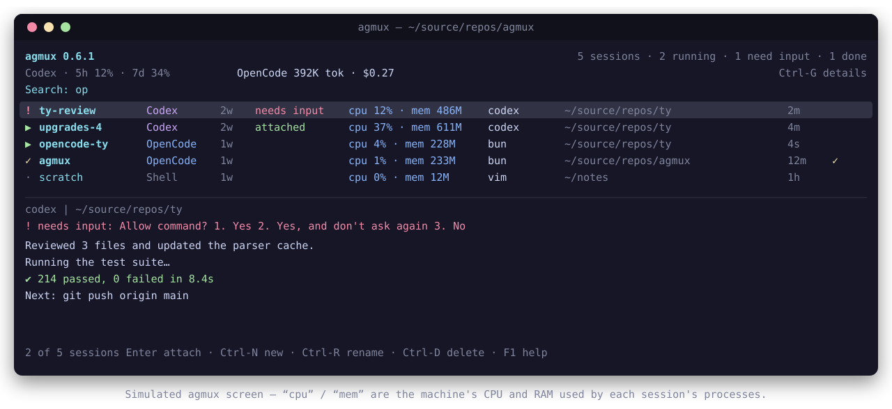

# agmux

**A terminal control panel for tmux and AI coding agents.**
One dependency-free Python file. Manage sessions running Codex / OpenCode /
Claude Code / …, see their state and resource use, get told when an agent
finishes or needs you, and check your usage limits — without leaving the
terminal.



```
agmux 0.5.1                     5 sessions · 2 running · 1 need input · 1 done
Codex · 5h 12% · 7d 34%       OpenCode 392K tok · $0.27        Ctrl-G details
Search:
! ty-review    Codex    2w  needs input  cpu 12% · mem 486M  codex  ~/source/repos/ty     2m
▶ upgrades-4   Codex    2w  attached     cpu 37% · mem 611M  codex  ~/source/repos/ty     4m
▶ opencode-ty  OpenCode 1w                cpu  4% · mem 228M  bun    ~/source/repos/ty     4s
✓ agmux        OpenCode 1w                cpu  1% · mem 233M  bun    ~/source/repos/agmux  12m ✓
· scratch      Shell    1w                cpu  0% · mem  12M  vim    ~/notes               1h
──────────────────────────────────────────────────────────────────────────────────────────
codex  |  ~/source/repos/ty
! needs input: Allow command?  1. Yes  2. Yes, and don't ask again  3. No
1 of 5 sessions   Enter attach · Ctrl-N new · Ctrl-R rename · Ctrl-D delete · F1 help
```

Here `cpu` is the machine's CPU usage and `mem` is resident RAM — both for the
session's own processes, **not** token, context-window, or rate-limit usage
(those are the percentages in the line above, from `Ctrl-G`).

## Why

tmux is excellent at keeping work alive remotely. It is less good at telling
you *which* session holds which agent, whether that agent is still working,
how much CPU and memory each session is burning, and whether you have blown
through your rate limit. `agmux` is a small, auditable layer that answers those
questions and stays out of the way.

- **One file, no packages.** Standard library only, plus the `tmux` and agent
  binaries you already have. No pip, no plugins, no daemon, no network.
- **Agent-aware.** Knows Codex, OpenCode, Claude Code, Gemini, Aider, Crush, and
  Goose, and can launch any of them — or a plain shell — in a tmux session.
- **Resource use per session.** A labelled `cpu X% · mem Y` figure next to each
  session, summed across all of that session's panes and their child processes —
  machine CPU and RAM, kept visually distinct from token and rate-limit usage.
- **Tells you when it's done.** Agent sessions started by agmux are flagged
  `✓` when they finish and fire a desktop notification.
- **Tells you when it needs you.** If an agent is waiting on a permission or
  confirmation prompt, agmux flags it `!`, sorts it to the top, and can notify
  you — so you are not left staring at a stalled session.
- **Live previews that stay current.** The preview and the read-only viewer
  render the pane's own colors and styles, always end on the newest output even
  if someone scrolled the pane up, and trim the agent's input composer and
  status footer so you see real output.
- **Usage at a glance.** Reads Codex's rate-limit windows from its logs and
  OpenCode's per-session cost/tokens from its database, side by side in the
  header and in a detail panel.
- **Portable settings.** An optional config file carries your project roots and
  preferences between machines.
- **Safe by construction.** No shell command strings, literal argument passing,
  exact-name deletion with revalidation, and filtered terminal output.

## Install (Linux)

Requires Python 3.8+ and `tmux`; agent sessions additionally need whichever
agent binaries you already use. Nothing is downloaded at runtime.

```bash
git clone https://github.com/T-Lind/agmux.git
cd agmux
./install.sh
```

`install.sh` is one command that:

1. links `agmux` (and the historical `cx`) into `~/.local/bin`,
2. adds bash completion to `~/.bashrc`,
3. adds the `Ctrl-b Ctrl-s` popup to `~/.tmux.conf`,
4. installs the `agmux(1)` man page, and
5. tells you if `~/.local/bin` is missing from `PATH`.

It is idempotent and reversible:

```bash
./install.sh --bin ~/bin      # choose where to link the command
./install.sh --no-integration # link only; do not touch dotfiles
./install.sh --uninstall      # remove the links and the managed blocks
```

Then reload: `source ~/.bashrc` and `tmux source-file ~/.tmux.conf`.
`make install` / `make uninstall` are thin wrappers over the same script.
Check everything with `agmux doctor`.

## Use

Run `agmux` to open the picker. Type to filter by session name, agent, command,
directory, or state; select with Up/Down or Tab/Shift-Tab; press Enter to attach
(or switch your current client when already inside tmux). Esc cancels. A preview
shows the selected session's active pane.

| Key | Action |
| --- | --- |
| type | filter sessions |
| `Up`/`Down`, `Tab`/`Shift-Tab` | select |
| `PageUp`/`PageDown`, `Home`/`End` | move through the list |
| `Enter` | attach / switch to the selected session |
| `Ctrl-N` | new session wizard (agent → directory → name) |
| `Ctrl-G` | usage-limit panel |
| `Ctrl-R` | rename the selected session |
| `Ctrl-D` / `Delete` | delete the selected session (typed confirmation) |
| `Ctrl-W` | add a detached shell window in the session's directory |
| `Ctrl-O` | read-only output viewer (keys never reach the pane) |
| `Ctrl-P` | show/hide the preview |
| `Ctrl-L` | refresh now · `Ctrl-U` clear search |
| `F1` | help · `Esc` cancel |

Inside tmux, **`Ctrl-b` then `Ctrl-s`** opens the same picker in a popup and
switches *your* terminal, leaving the running processes untouched.

## Command line

```bash
agmux                                   # the picker
agmux list                              # one line per session (agent, state, dir, CPU/mem)
agmux list --json                       # machine-readable sessions
agmux attach upgrades-4                 # switch/attach to a session
agmux new ty-fix --cwd ~/source/repos/ty
agmux new review --agent opencode --cwd ~/source/repos/ty --detach
agmux new notes --agent shell           # a plain shell session
agmux new explain --agent codex -- --model gpt-5   # args after -- go to the agent
agmux rename ty-fix ty-review
agmux shell ty-review --name logs       # add a detached shell window
agmux delete ty-review                  # asks you to type the name
agmux kill ty-review --yes              # alias of delete, skip the typing
agmux usage                             # rate-limit windows, read locally
agmux agents                            # known agents and whether they're installed
agmux preview ty-review                 # recent output, with the pane's colors
agmux peek ty-review                    # live read-only viewer
agmux watch                             # notify when an agent needs input
agmux last                              # previous session (inside tmux)
agmux detach
agmux doctor                            # check tools and integration
```

### Agents

`--agent` accepts `codex` (default), `opencode`, `claude`, `gemini`, `aider`,
`crush`, `goose`, or `shell`. `--shell` is a shortcut for `--agent shell`. When
you run `agmux doctor` or `agmux agents`, agmux reports which agent binaries are
actually installed.

For sessions **started outside agmux**, the agent is inferred from the
foreground command in the active pane, so an `opencode` or `codex` process is
labelled even if agmux did not start it.

### CPU and memory per session

Each row shows `cpu X%` and `mem Y` for the whole session: the active process in
every pane plus its descendants. The `cpu` and `mem` words are deliberate —
these are the machine's CPU and RAM used by that session, not token,
context-window, or rate-limit figures. It is sampled once per refresh from `ps`
(pid, parent, CPU%, RSS only), so one query covers every session, and is off by
default on platforms without a compatible `ps`. Set `AGMUX_RESOURCES=0` or pass
`--no-resources` to hide it. In JSON the fields are `cpu` (percent) and `rss`
(kibibytes):

```bash
agmux list --json | jq '.[] | {name, status, cpu, rss}'
```

### Previews always show the newest output

The preview and the read-only viewer capture to the *end* of the pane's
history, so they end on the latest line even when the pane (or the client
viewing it) has been scrolled up — you always see what the agent is doing now.
The agent's input composer and status footer are trimmed so real output fills
the space, and short output hugs the bottom like a real terminal. Toggle the
preview with `Ctrl-P`; set `AGMUX_TRIM_CHROME=0` to keep the agent chrome.

### Completion notifications

When agmux starts an agent, it wraps the process just enough to notice exit. The
session is marked running, then finished on exit, and agmux:

1. flags the session with `✓` in the picker (cleared when you attach),
2. prints a tmux status message to attached clients, and
3. fires a desktop notification via `notify-send` when a session bus is
   available.

Notifications are on by default. Disable per-session with `--no-notify`, or
globally with `AGMUX_NOTIFY=0`. To route notifications anywhere else, set
`AGMUX_NOTIFY_CMD` to a command with `{title}`, `{body}`, `{session}`, and
`{exit_code}` placeholders — for example:

```bash
export AGMUX_NOTIFY_CMD='ntfy publish mytopic "{body}"'
```

The command is split with shell-like quoting and executed directly; no shell is
involved.

### When an agent needs you

agmux reads the active pane's visible screen and classifies each agent session
as **working**, **idle** (alive at its prompt), or **blocked** (a permission,
confirmation, or question prompt). Blocked sessions are sorted to the top of the
picker and flagged `!`, and the picker header counts how many need input. The
detected prompt line is shown above the preview and appended to `agmux list`.

For agent sessions agmux starts, a small watcher thread polls the pane while the
agent runs and raises the same desktop/tmux notification for a blocked prompt.
For sessions started elsewhere, run the standalone watcher, which notifies on
any transition into the blocked state:

```bash
agmux watch                # poll every few seconds until interrupted
agmux watch --once         # a single pass (handy in scripts)
```

Detection is heuristic — agents draw their prompts differently and change them
over time. The defaults cover common `[y/N]` / "Allow …" / "Would you like to …"
/ numbered-approval forms. Extend them with `AGMUX_BLOCKED_PATTERNS` and
`AGMUX_WORKING_PATTERNS`: `'|'`-joined regular expressions appended to the
built-ins, matched case-insensitively against the last screen lines.

Entering a session clears any tmux copy-mode on its panes (`send-keys -X
cancel`), so you always land on the live view rather than a stale scrollback.

### Usage limits

**Codex.** Codex records token counts and rate-limit windows in its local
session logs. agmux reads the newest one under `$CODEX_HOME/sessions` (default
`~/.codex`) and shows the 5-hour and 7-day windows, percent used, and reset
time — in the header and in the full panel (`Ctrl-G`).

**OpenCode.** OpenCode does not expose account rate limits locally, but it
stores per-session cost and token counts in its SQLite database. agmux reads
that (read-only) and shows recent sessions' cost and tokens next to the Codex
windows. Set `OPENCODE_DATA_DIR` if your database lives elsewhere.

Both are local file reads; agmux makes **no network requests** and reads no
credentials. Other agents do not expose comparable local data, so the panel
says so rather than guessing.

## Projects and configuration

The new-session wizard lists the immediate subdirectories of your **project
roots** as candidate working directories. By default that is `~/source/repos`;
set `AGMUX_REPOS` to change it. It accepts several roots separated by `:`, and
`~` is expanded:

```bash
export AGMUX_REPOS="$HOME/source/repos:$HOME/work:$HOME/notes"
```

These are just convenient launch folders — agmux lists and manages sessions from
your **local tmux server**, and every session stores its own working directory.

### A config file instead of a wall of exports

For settings you want on every shell, put them in an optional
`~/.config/agmux/config` (override with `AGMUX_CONFIG`, which must be set
*before* startup). Environment variables always win, so you can keep shared
defaults in the file and override them per shell:

```ini
# ~/.config/agmux/config
repos = ~/source/repos:~/work
agent = codex
resources = 1

# extra "needs input" heuristics, '|'-joined regexes
blocked_patterns = \[y/N\]|continue\?
```

Recognized keys: `repos`, `agent`, `tmux_socket`, `notify`, `notify_cmd`,
`watch_interval`, `blocked_patterns`, `working_patterns`, `trim_chrome`,
`resources`, `ascii`, `bin`, `codex_home`, `opencode_data_dir`.

### Using it across machines

agmux is one file and talks to whichever tmux server it is pointed at, so the
usual setup is to install it on each machine (`git clone && ./install.sh`) and
keep `~/.config/agmux/config` in your dotfiles. Sessions do **not** federate
across machines — a session lives on the tmux server where it was created.
To work with a remote machine, run agmux there (for example over SSH, or via
`tmux -L`/`AGMUX_TMUX_SOCKET` against a remote socket). agmux itself still makes
no network connections; it only ever reads the local tmux server and local
files.

### Plain shells

You do not need an agent to use agmux. `agmux new scratch --agent shell`, the
picker's `Ctrl-N → Shell`, and `Ctrl-W` all create ordinary tmux sessions and
windows — start a build, tail a log, run `htop`, whatever.

## Configuration reference

Every setting has an environment variable; all are optional.

| Variable | Meaning | Default |
| --- | --- | --- |
| `AGMUX_AGENT` | default agent for `new` | `codex` |
| `AGMUX_REPOS` | project roots listed by the new-session wizard (`:`-separated) | `~/source/repos` |
| `AGMUX_CONFIG` | config file to load | `~/.config/agmux/config` |
| `AGMUX_TMUX_SOCKET` | tmux socket to use | current or default |
| `AGMUX_RESOURCES` | `0` hides per-session CPU/memory | `1` |
| `AGMUX_NOTIFY` | `0` disables completion notifications | `1` |
| `AGMUX_NOTIFY_CMD` | custom notification command | unset |
| `AGMUX_WATCH_INTERVAL` | seconds between blocked-prompt checks | `3` |
| `AGMUX_BLOCKED_PATTERNS` | extra `|`-joined regexes for "needs input" | unset |
| `AGMUX_WORKING_PATTERNS` | extra `|`-joined regexes for "working" | unset |
| `AGMUX_TRIM_CHROME` | `0` keeps agent input/footer lines in previews | `1` |
| `AGMUX_ASCII` | `1` forces ASCII glyphs | unset |
| `AGMUX_BIN` | path to `agmux` used by the tmux popup | `agmux` |
| `CODEX_HOME` | where Codex stores session logs | `~/.codex` |
| `OPENCODE_DATA_DIR` | where OpenCode stores its database | `~/.local/share/opencode` |

`CX_REPOS` and `CX_TMUX_SOCKET` are still honored for backwards compatibility.

## Security

agmux is deliberately small so you can read all of it. It uses only the Python
standard library and local `tmux`/agent binaries; it reads local tmux metadata,
directory names, one `ps` process listing (pid, parent, CPU%, RSS), the optional
config file, and Codex/OpenCode usage logs; it makes no network requests and
reads no credential files. Session names and pane output are filtered for
control characters before display. Agent arguments are passed as literal argv
(never a shell string). Deletion targets exactly one resolved session and
re-validates it immediately before killing. See [SECURITY.md](SECURITY.md) for
the scope and how it was verified.

## Verification

```bash
make test                                  # lint + unit tests + UI smoke test
python3 -m unittest discover -s tests -v   # isolated tmux socket, no real sessions
python3 tests/ui_smoke.py                  # drives the TUI in private PTYs
bash -n install.sh completion.bash
```

Both suites use a private tmux socket and a fake agent binary, so they never
touch your real sessions. The unit suite covers creation, exact selection,
rename, preview, literal argument quoting, deletion confirmation and
revalidation, shell windows, agent detection, per-session CPU/memory sampling,
previews staying on the newest output while scrolled, multi-root project
listing, ANSI parsing/rendering, screen classification, copy-mode cancellation,
usage parsing, notifications, config loading, and `NO_COLOR`/piped output. The
smoke test drives the picker, viewer, usage panel, new-session wizard, popup
switching, and delete flow end to end.

## Compatibility

The command was previously named `cx`; `install.sh` keeps a `cx` symlink, and
the old `CX_*` environment variables still work. `completion.bash` completes
both names. Linux is supported; other Unix systems work when their `ps` supports
`-eo pid=,ppid=,pcpu=,rss=` (macOS mostly does) and otherwise simply show no
resource figures.

## Uninstall

```bash
./install.sh --uninstall       # or: make uninstall
```

This removes the `agmux`/`cx` links, the managed blocks in `~/.bashrc` and
`~/.tmux.conf`, and leaves your sessions and dotfiles otherwise intact.

## License

MIT — see [LICENSE](LICENSE).
